# The project, explained from scratch

**Who this is for:** anyone — including future me — who has never worked in a bank and wants to
understand this project end to end: the money concepts, the problem, every variable, every
decision, and what we found.

> **How to read the diagrams:** they are written in *Mermaid*. GitHub draws them automatically.
> In VS Code, install the extension **"Markdown Preview Mermaid Support"** and open the preview
> (`Ctrl+Shift+V`).

> **Rule for every number in this document:** it was produced by the project's code (a SQL query,
> a notebook, or the small worked-example calculation noted next to it). Nothing is made up.

---

## Contents

1. [The whole project in two minutes](#1-the-whole-project-in-two-minutes)
2. [Money basics: loans and interest](#2-money-basics-loans-and-interest)
3. [Mortgages: term, amortization, renewal](#3-mortgages-term-amortization-renewal)
4. [Where interest rates come from](#4-where-interest-rates-come-from)
5. [The four loan products in this project](#5-the-four-loan-products-in-this-project)
6. [When borrowers struggle: delinquency and default](#6-when-borrowers-struggle-delinquency-and-default)
7. [How banks prepare for losses: expected loss and provisions](#7-how-banks-prepare-for-losses-expected-loss-and-provisions)
8. [The problem statement](#8-the-problem-statement)
9. [The data: what is real and what is simulated](#9-the-data-what-is-real-and-what-is-simulated)
10. [The approach, step by step](#10-the-approach-step-by-step)
11. [Every variable, explained](#11-every-variable-explained)
12. [What we included, what we left out, and why](#12-what-we-included-what-we-left-out-and-why)
13. [Assumptions](#13-assumptions)
14. [The biggest challenges](#14-the-biggest-challenges)
15. [Results and conclusion](#15-results-and-conclusion)
16. [Limitations](#16-limitations)
17. [Power BI dashboard results](#17-power-bi-dashboard-results)
18. [Interview questions to practise](#18-interview-questions-to-practise)

---

## 1. The whole project in two minutes

In Canada, most people who buy a house borrow the money (a **mortgage**). They pay it back over
**25 years**, but their **interest rate is only locked for 5 years**. After 5 years they must
**renew** at whatever the rate is *then*.

Between 2020 and early 2022, rates were at record lows (~2%). Then they jumped (to ~5–6%).
So millions of families who locked in cheap rates are now renewing at much higher ones — and their
monthly payment jumps. That jump is called **payment shock**.

A bank wants to know, *before* it happens:

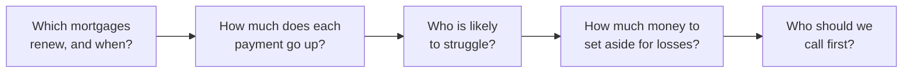

This project answers those five questions. It uses **real** Canadian data (interest rates from the
Bank of Canada, unemployment from Statistics Canada, mortgage arrears from the Canadian Bankers
Association) and a **simulated** set of 50,000 loans (banks don't publish customer data) that is driven
by the real data and then **checked against it**. It stores everything in a database, answers the
questions with **SQL**, draws charts with **Python**, builds a simple **prediction model**, and feeds a
**Power BI** dashboard.

---

## 2. Money basics: loans and interest

### What is a loan?

A **loan** is money a bank gives you now, which you promise to pay back later, plus a fee.

- **Principal** — the amount you borrowed (e.g. $500,000).
- **Interest** — the fee for borrowing, charged as a percentage per year.
- **Interest rate** — that percentage (e.g. 5% per year).
- **Balance** (or **outstanding balance**) — how much you still owe right now.

> **Analogy — renting money.** Interest is *rent* on money. If you rent an apartment, you pay
> rent every month for using it. If you "rent" $500,000 from a bank, you pay interest every month
> for using it. The interest rate is the rent price.

### What is a monthly payment?

Most loans are paid back in equal monthly instalments. Each payment has two parts:

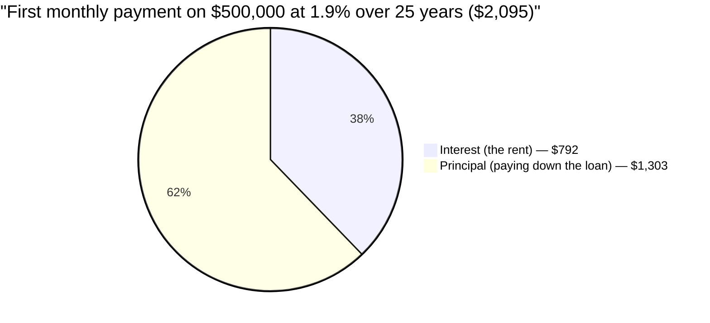

*(Calculated with the standard loan payment formula, the same one used in notebook 01.)*

Early on, a big chunk of each payment is interest. As the balance falls, the interest part shrinks
and more goes to paying down the loan. Paying a loan down like this is called **amortization**.

### Why does the rate matter so much?

Because interest is charged on the **whole balance**, a small change in the rate is a big change
in dollars on a big loan. On $500,000, every 1 percentage point is roughly $5,000 more interest
per year.

**Percentage point (pp)** vs **percent**: going from 2% to 5% is a rise of **3 percentage points**,
but a rise of **150 percent**. Bankers say "pp" (or **basis points**: 1 bp = 0.01pp, so 3pp = 300bp)
to avoid confusion.

---

## 3. Mortgages: term, amortization, renewal

A **mortgage** is a loan to buy a home. The home is the **collateral**: if you stop paying, the bank
can take and sell it.

### The two different time periods (the heart of the project)

| | Means | Typical in Canada |
| --- | --- | --- |
| **Amortization** | How long until the loan is fully paid off | **25 years** |
| **Term** | How long the interest rate is locked | **5 years** |
| **Renewal** | Signing a new rate when the term ends | Every 5 years |

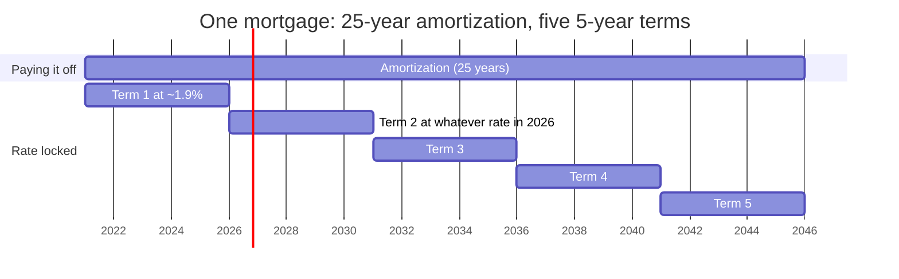

> **Analogy — a phone contract.** You'll own the phone for years, but the *price plan* is only
> locked for a 2-year contract. When it ends, you sign a new plan at today's prices. You can't
> keep the old price. A Canadian mortgage works the same way, but every 5 years.

**Why this is a Canadian problem:** in the US, the most common mortgage locks the rate for the
full 30 years. In Canada, the rate is typically locked for only 5. So when rates rise, Canadian
households feel it at renewal — American ones mostly don't.

### Worked example: payment shock

*(Calculated with the standard payment formula; same maths as notebook 01.)*

A family borrows **$500,000** over **25 years** at **1.9%** in 2021.

| | Before renewal (2021) | After renewal (2026) |
| --- | --- | --- |
| Balance | $500,000 | $418,032 (they paid off $81,968 in 5 years) |
| Rate | 1.9% | 5.0% |
| Years left | 25 | 20 |
| **Monthly payment** | **$2,095** | **$2,759** |

**+$664 per month, about +$7,966 per year, a 31.7% higher payment.** Same house, same family,
same loan — only the rate changed. That increase is **payment shock**:

$$\text{payment shock \%} = \frac{\text{new payment}}{\text{old payment}} - 1$$

### Fixed vs variable rate

| | Fixed rate | Variable rate |
| --- | --- | --- |
| Rate during the term | Locked | Moves with the **prime rate** (see §4) |
| When rates rise | Shock arrives **all at once, at renewal** | Pain arrives **gradually, month by month** |
| In this project | The renewal-shock analysis | Affects the monthly delinquency simulation |

That's why the main renewal analysis covers **fixed** mortgages only: variable borrowers have
already felt the increases as they happened.

---

## 4. Where interest rates come from

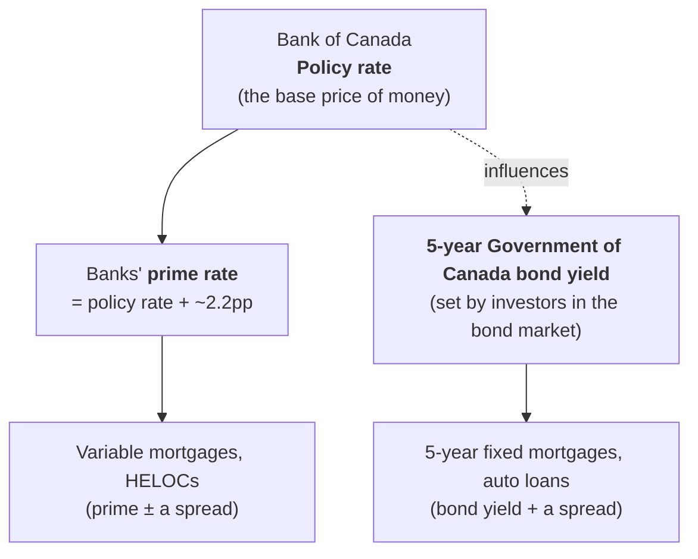

| Term | Plain meaning |
| --- | --- |
| **Bank of Canada (BoC)** | Canada's central bank. Sets the policy rate to keep inflation near 2%. |
| **Policy rate** (overnight rate) | The base price of money in Canada. When it goes up, every other rate follows. |
| **Prime rate** | The rate banks use as the base for variable loans. In our data it's always policy + 2.20pp (0.25% → 2.45%; 2.25% → 4.45%). |
| **Government of Canada (GoC) bond** | The government borrowing money from investors. |
| **Bond yield** | The interest investors earn on that bond. Banks fund 5-year fixed mortgages in a way that tracks the **5-year** yield. |
| **Spread** | The extra a bank adds on top of its base rate to cover costs, risk and profit. |
| **Posted rate** | The "sticker price" a bank advertises. **Almost nobody pays it** — they get a discount. |

### The posted-rate trap

The Bank of Canada publishes a "conventional 5-year mortgage rate" — but it's the **posted** rate.

| Month | Posted 5-yr rate | 5-yr bond yield | Bond yield + 1.40 (what people actually paid, approx.) |
| --- | --- | --- | --- |
| Jan 2021 | 4.79% | 0.43% | **1.83%** |
| Oct 2023 | 7.04% | 4.23% | **5.63%** |
| Sep 2026 | 6.09% | 3.57% | **4.97%** |

*(From `dim_month` in the warehouse.)* If we'd used the posted rate, every payment would be far too
high. So the project prices fixed mortgages at **5-year bond yield + 1.40pp**.

### The real rate story

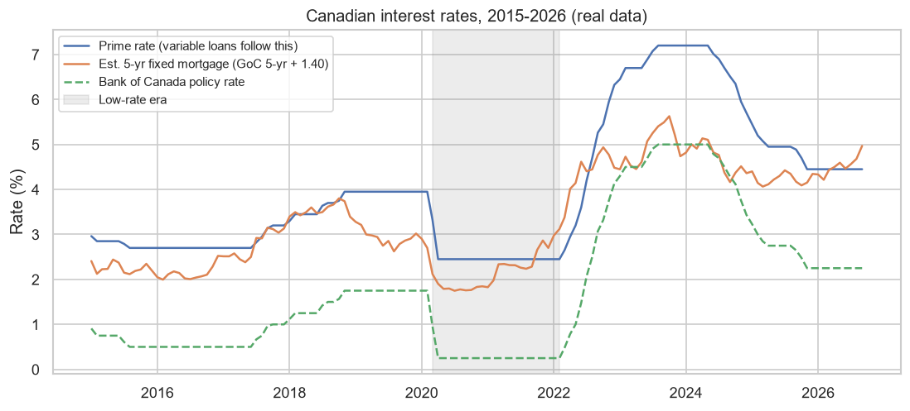

- **2015–2019:** normal-ish rates.
- **Mar 2020 – Feb 2022 (grey band):** COVID emergency — policy rate cut to **0.25%**. Fixed
  mortgages around **1.8–2%**. Millions of people locked in.
- **2022–2023:** inflation → fastest rate rises in decades. Policy rate to **5%**, prime to **7.2%**.
- **2024–2026:** rates come down, but not back to 2%. In Sep 2026 the policy rate is **2.25%**
  and a 5-year fixed is about **5%**.

**The project's whole premise is in this chart:** people who locked in inside the grey band renew
at the orange line's level today.

### Why monthly averages?

Rates are published daily or weekly; we use one value per month — the **average**. A loan signed
"in March" could be signed any day in March, so the typical rate across the month is the fairest
single number. (The alternative, month-end, suits snapshot reporting, not pricing.)

---

## 5. The four loan products in this project

| Product | What it is | Secured by | Rate type | Typical size in our book |
| --- | --- | --- | --- | --- |
| **Mortgage** | Loan to buy a home | The home | Fixed (75%) or variable (25%) | $523k average |
| **HELOC** | *Home Equity Line Of Credit* — borrow against the part of your home you own | The home | Variable (prime + 0.5) | $135k average |
| **Auto loan** | Loan to buy a car, paid off over 6 years | The car | Fixed | $42k average |
| **Credit card** | Revolving credit — borrow, repay, borrow again | Nothing | Fixed APR | $10k average |

*(Averages from `dim_loan`.)*

- **Secured** = backed by something the bank can sell (house, car). **Unsecured** = backed by
  nothing but your promise. Unsecured loans default more and lose more, so they charge much more.
- **APR** (Annual Percentage Rate) — the yearly interest rate on a card. Ours average **18.9%**
  vs **3.2%** for mortgages.
- **Equity** — the part of your home you actually own: home value minus mortgage balance.

> **Analogy — pawn shop vs IOU.** Lending against a house is like a pawn shop: if you don't pay,
> they keep the item. A credit card is like an IOU from a friend: if they don't pay, you just lose.
> That's why the IOU costs more.

---

## 6. When borrowers struggle: delinquency and default

### The vocabulary

| Term | Plain meaning |
| --- | --- |
| **Current** | Paid on time. All good. |
| **Delinquent** / **in arrears** | Behind on payments. |
| **DPD (days past due)** | How late, in 30-day buckets: 30, 60, 90, 120. |
| **Impaired** | 90+ days late — the bank now seriously doubts it will be repaid. |
| **Default** | The bank stops expecting normal repayment and writes the loan off (in our project: after 120 dpd). |
| **Cure** | A late borrower catches up and becomes current again. |
| **Roll** (roll forward) | A late borrower misses another payment and moves to the next bucket. |
| **Roll rate** | The chance a late borrower gets *later* rather than catching up. |

### The journey of a loan (a "state machine")

```mermaid
stateDiagram-v2
    direction LR
    Current --> DPD30: misses a payment (hazard)
    DPD30 --> Current: cures
    DPD60 --> Current: cures
    DPD90 --> Current: cures
    DPD120 --> Current: cures
    DPD30 --> DPD60: rolls
    DPD60 --> DPD90: rolls
    DPD90 --> DPD120: rolls
    DPD120 --> Default: rolls
    Default --> [*]: leaves the book
```

Each month, every loan is in exactly one box. Two numbers drive the moves:

- **Hazard** — the monthly chance a *current* loan misses a payment (small: ~0.2% for mortgages, ~0.5% for cards).
- **Cure rate** — the monthly chance a *late* loan catches up (30–50% depending on product).

**Two real loans from the simulation** (from `fact_loan_month`):

| Loan | Product | What happened |
| --- | --- | --- |
| 59 | Mortgage | Current until **Jul 2025 → 30 dpd**, then **Aug 2025 → current** again. A *cure*. |
| 3 | Credit card | **Aug 2024 → 30 dpd → Sep 60 → Oct 90 → Nov 120 → Dec 2024 default.** Rolled four times in a row. |

Across all 1,688,653 loan-months, 1,672,637 were "current" — **99% of the time, loans are fine**.
Risk lives in the other 1%.

### Credit score

A **credit score** (300–900 in Canada) summarises a person's history of paying debts. Higher =
more reliable. We group scores into **credit bands**:

| Band | Loans in our book | Rough meaning |
| --- | --- | --- |
| Below 600 | 2,115 | Weak history ("subprime") |
| 600–659 | 7,661 | Fair |
| 660–719 | 15,222 | Good |
| 720–779 | 15,068 | Very good |
| 780+ | 9,934 | Excellent ("super-prime") |

*(From `dim_loan`.)* In the simulation, **every 100 points lower doubles the risk of missing a payment.**

---

## 7. How banks prepare for losses: expected loss and provisions

A bank knows some loans will go bad. It can't know *which ones*, but it can estimate *how much*,
and it must **set money aside in advance**. That money is the **provision** (or *allowance*).
Canadian accounting rules (IFRS 9) and the banking regulator (OSFI) require it.

> **Analogy — a rainy-day fund.** You don't know which day your car will break down, but you know
> roughly what repairs cost per year, so you save that much. A provision is the bank's rainy-day
> fund for bad loans.

### The formula

$$\textbf{Expected Loss} = \underbrace{\text{Balance}}_{\text{how much is owed}} \times \underbrace{\text{PD}}_{\text{chance they stop paying}} \times \underbrace{\text{LGD}}_{\text{share actually lost}}$$

| Term | Plain meaning | Example |
| --- | --- | --- |
| **Exposure** / balance (EAD) | How much the bank could lose | $720,000 mortgage |
| **PD** — probability of default | Chance the borrower defaults (we use the next 12 months) | 0.76% |
| **LGD** — loss given default | If they default, what share of the balance is really lost after selling the house/car | 10% for a mortgage (the house covers most of it); 85% for a card |

**Why LGD differs:** if a mortgage defaults, the bank sells the house and gets most of its money
back. If a credit card defaults, there's nothing to sell.

### Worked example — loan 30258, a real row from `fact_renewal`

A borrower in Alberta, credit score **586** (band "Below 600"), owes **$719,998** at renewal in
**Oct 2026**. Their rate goes from **2.83% → 5.14%** (+2.31pp). Payment: **$3,932 → $4,807** a month (+22.3%).

| Step | Calculation | Result |
| --- | --- | --- |
| Normal 12-month PD for "Below 600" mortgages | measured from the data | 0.55% |
| × Alberta's **real** arrears factor | Alberta mortgages fall 90+ days behind 1.38× as often as Canada's (CBA) | **0.76%** |
| Stressed PD after the rate jump | 0.76% × (1 + 0.25 × 2.31) | **1.19%** |
| Expected loss *before* | $719,998 × 0.76% × 10% | **$545** |
| Expected loss *after* | $719,998 × 1.19% × 10% | **$860** |
| **Incremental provision** | $860 − $545 | **$315** |

That $315 is the extra money the bank should set aside *because of this one renewal*. Add up all
6,716 renewing mortgages and you get the project's provision figure. Sort borrowers by this number
and you get the **call list** — loan 30258 is **#1**.

> **Why only 25% per pp?** That's the project's assumption for how much harder each 1pp of
> rate rise makes it to keep paying (see §13). It's labelled as an assumption everywhere.

---

## 8. The problem statement

> Between 2025 and 2027, a large share of Canadian mortgages written during the low-rate era reach
> the end of their 5-year fixed term and reprice at today's higher rates. For our retail loan book:
>
> 1. **Which** mortgages renew, and when?
> 2. **How big** is the payment shock — in % and in dollars?
> 3. **Which segments** (credit band, province, product) carry the most risk?
> 4. **How much extra provision** does the renewal wave imply?
> 5. **Who should the bank call first** to offer help (a longer amortization, a different product)
>    *before* they fall behind?

**Why it's a good analyst problem:** it's real (the biggest Canadian retail-banking topic of
2025–27), the answer is in **dollars** (a provision amount and a ranked list), and it's aimed at
financial services — the largest employer of entry-level analysts in Toronto.

---

## 9. The data: what is real and what is simulated

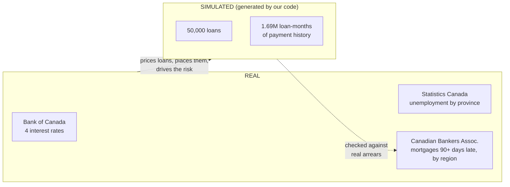

**Why simulate?** No Canadian bank publishes customer-level loan data — it's private. Banks
themselves build simulated portfolios to test risk models for the same reason. What makes ours
*meaningful* rather than invented:

- **Rates:** every loan is priced off the real rate in the month it was signed, and real rate rises push risk up.
- **Location:** loans are spread across provinces the way Canada's real mortgages are (CBA counts).
- **Where:** regions with higher real arrears (Saskatchewan: 2.58× Canada's) carry more risk.
- **When:** risk rises in months when real unemployment is higher.
- **Checked:** the simulated arrears are then compared with the real ones (§10, Step 6b).

**How we stay honest:**

- Every simulated row has a column `source = "SIMULATED - not real customers"`.
- Every chart built on loan data carries a footnote saying so.
- Findings are described as "in this simulated portfolio", not as facts about real Canadians.

**What's a seed?** Computers make "random" numbers from a starting value called a **seed**. Same
seed → same "random" numbers → the same 50,000 loans every run. That makes the project
**reproducible**: anyone who runs it gets exactly our numbers. (We checked: re-running produces
byte-for-byte identical files.)

---

## 10. The approach, step by step

### The big picture

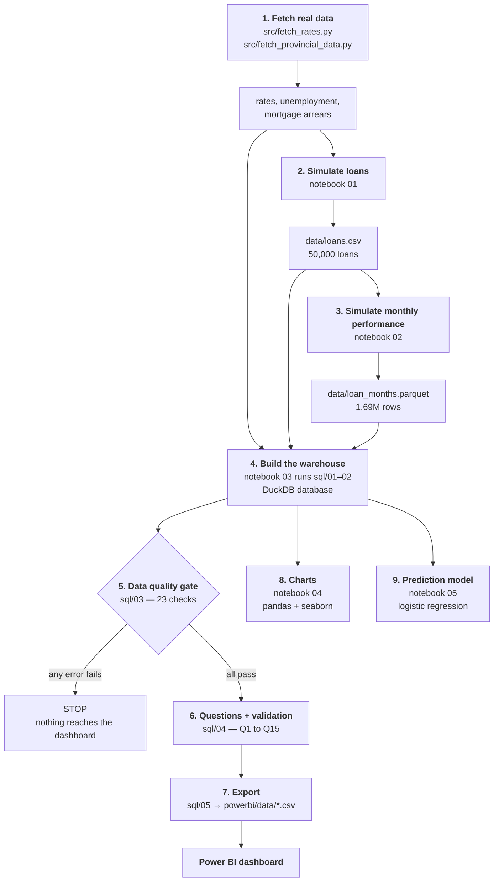

**Why this order?** Each step only depends on the ones before it, so if something breaks you
re-run from that step. Data flows one way: raw → cleaned → analysed → shown.

### Step 1 — Fetch real data (`src/fetch_rates.py`, `src/fetch_provincial_data.py`)

- **Rates:** calls the Bank of Canada's free **Valet API** (an *API* is a web address that returns
  data instead of a web page) for four series, averages each to one value per month, and saves 141
  months (Jan 2015 – Sep 2026). It stops with an error if any month is missing a value.
- **Unemployment:** calls Statistics Canada's API for the monthly unemployment rate and population
  of all 10 provinces plus Canada (table 14-10-0287, seasonally adjusted), all in one request.
- **Arrears:** downloads the Canadian Bankers Association's Excel file of mortgages 90+ days behind,
  by region, monthly since 1995. It keeps the raw file, reshapes it into one row per region per
  month, and checks there are no gaps. The CBA publishes with a lag (its file ends Jul 2026), so the
  script logs a warning and **never fills in** the missing months.

### Step 2 — Simulate the loans (notebook 01)

For each of 50,000 loans we randomly draw, using the shares in `config/pipeline.yml`, except the
province, which follows where Canada's mortgages really are (CBA count by region; the four Atlantic
provinces are split by real population). That puts 43.8% of loans in Ontario and 19.0% in Quebec:

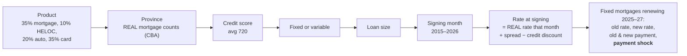

Key rules:

- **Fixed mortgage rate** = 5-yr bond yield + 1.40pp, never below 1.35%.
- **Variable mortgage** = prime − 1.00pp, never below 0.95%.
- **Better credit → cheaper rate**, but by product: mortgages barely (0.15pp per 100 points —
  banks compete on headline rate), cards a lot (5.5pp per 100 points).
- **Renewals after Sep 2026** (the last real month) use the Sep 2026 rate **held flat**. We never
  forecast rates.

### Step 3 — Simulate monthly performance (notebook 02)

For each of the 42 months from **Apr 2023 to Sep 2026**, every open loan moves through the state
machine in §6. A loan's monthly **hazard** is:

$$\text{hazard} = \underbrace{\text{base}}_{\text{product}} \times \underbrace{2^{(700 - \text{score})/100}}_{\text{credit score}} \times \underbrace{(1 + 0.25 \times \text{rate rise})}_{\text{real rates}} \times \underbrace{\text{where}}_{\text{real arrears}} \times \underbrace{\text{when}}_{\text{real unemployment}}$$

- **Base hazard** is set so each product lands near a published Canadian 42-month default rate:
  mortgage ~0.5%, HELOC ~0.8%, auto ~3%, card ~5%. The maths: to default, a loan must miss once
  and then fail to cure 4 months running, so default ≈ 38 × hazard × (1 − cure rate)⁴.
  (38 not 42, because a miss in the last 4 months can't reach default in time.)
- **Rate increase** = how much the loan's rate has risen since signing: the renewal jump for fixed
  mortgages (from their renewal month on), or prime-now minus prime-at-signing for variable loans.
- **Where** = the region's **real** share of mortgages 90+ days behind ÷ Canada's (Canadian Bankers
  Association). Saskatchewan 2.58, Manitoba 1.49, Alberta 1.38, Atlantic 1.28, Ontario 0.89,
  BC 0.85, Quebec 0.78.
- **When** = Canada's **real** unemployment rate that month ÷ its average over the 42 months
  (Statistics Canada): 0.80 in Apr 2023, rising to 1.08 by 2025.

**Why two separate real factors?** Before choosing, we checked the real data. Real arrears and real
unemployment move together **over time** (correlation 0.69) but not **across regions** (−0.29):
Saskatchewan and Manitoba have some of the lowest unemployment and the highest arrears. So
unemployment decides *when* stress rises, and real arrears decide *where* it's high.

> **Analogy — a slippery road.** Everyone drives (pays) safely most days. The hazard is the chance
> of skidding on a given day. A weaker driver (low credit score) skids more. Ice on the road
> (higher rates) makes everyone skid more. Some roads are always more slippery (high-arrears regions),
> and bad weather (high unemployment) makes every road worse. Once you skid, you either recover
> (cure) or slide further (roll).

### Step 4 — Build the warehouse (notebook 03 + `sql/01`, `sql/02`)

A **database** stores tables you can query with **SQL**. **DuckDB** is a database that lives in
one file — no server to install, so anyone can run the project.

**Layers:**

| Layer | What's in it | Why |
| --- | --- | --- |
| `raw` | The source files, loaded **unchanged** | If a later step has a bug, rebuild from here without re-downloading |
| `mart` | Clean tables designed for analysis | What the questions and dashboard read |
| `quality` | Results of the data-quality checks | Quality becomes visible and reportable |

**Star schema** — the standard way to organise analysis tables:

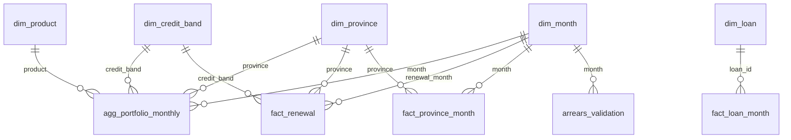

- **Dimension tables** (`dim_`) **describe things**: months, provinces, products, credit bands, loans.
  They answer "who / what / when / where".
- **Fact tables** (`fact_`) **hold the numbers**: balances, payments, losses.
- **Grain** = what one row means. `fact_loan_month`: one loan in one month.
  `fact_renewal`: one renewing mortgage. `fact_province_month` (REAL): one province in one month.
  `arrears_validation`: one CBA region in one month. Knowing the grain stops you double-counting.

> **Analogy — a shop receipt.** The receipt lines are the *fact* (item, quantity, price). The
> product catalogue, the store list, and the calendar are *dimensions*. You can slice sales by any
> dimension because each receipt line points to them.

**Store amounts, never ratios.** We store `delinquent_balance` ($), not `delinquency_rate` (%).

| Province | Delinquent | Balance | Rate |
| --- | --- | --- | --- |
| A | $1 | $10 | 10% |
| B | $1 | $1,000 | 0.1% |
| **Average of the rates** | | | **5.05% ← wrong** |
| **SUM ÷ SUM** | $2 | $1,010 | **0.2% ← right** |

*(Illustrative numbers.)* Averaging ratios lets a tiny account count as much as a huge one.

### Step 5 — Data quality gate (`sql/03_quality_checks.sql`)

23 checks, each counting rows that **break** a rule, on both the simulated and the real data. If any
"error" check fails, the build **stops**.

| Dimension | Question it asks | Example check |
| --- | --- | --- |
| **Completeness** | Is anything missing? | Every loan has a product, province, credit score; unemployment exists for every province every month |
| **Uniqueness** | Is anything duplicated? | One row per loan per month |
| **Validity** | Are values possible? | Credit scores between 300 and 900 |
| **Consistency** | Do tables agree? | No loan appears after the month it defaulted |
| **Reconciliation** | Do totals match the source? | Total balance in the warehouse = source file (within 0.01%); the CBA's regions add up to its Canada total |

> **Analogy — a cashier's end-of-day count.** Before closing, the cashier checks the till matches
> the receipts. If it doesn't, nobody goes home until it's explained. Reconciliation is that count
> for data.

**Result: 23 of 23 pass.** Banks ask for exactly this in job postings (Scotiabank's data analyst
posting mentions data quality and reconciliation three separate times).

### Step 6 — Business questions (`sql/04_analysis_queries.sql`)

| Query | Question |
| --- | --- |
| Q1 | How big is the renewal wave each year, and how hard does it hit? |
| Q2 | How is the shock distributed (bands)? |
| Q3 | Does the year the term started drive the shock? |
| Q4 | Which provinces carry the most risk, by size and by intensity (provision per $1M)? |
| Q5 | Does the shock fall on weaker borrowers? (lift) |
| Q6 | Where should the extra provision be held? |
| Q7 | Portfolio health today, by product |
| Q8 | Default rates by product × credit band |
| Q9 | Did the rate spike show up in HELOCs? |
| Q10 | Who do we call first? |
| Q11 | Data quality summary |
| Q12 | Headline numbers (the dashboard's KPI cards) |
| Q13 | Simulated vs real arrears, by region |
| Q14 | Simulated vs real arrears, national trend by quarter |
| Q15 | Validation in one row: level, correlations, and what real unemployment explains |

**Lift** (Q5) — a band's share of a group ÷ its share of everyone. If "Below 600" is 4.5% of all
renewals and 3.9% of high-shock renewals, lift = 3.9 / 4.5 = 0.86 → slightly *under*-represented.
Lift > 1 means over-represented. Always compare to the base — "X% of high-shock loans are
subprime" means nothing without knowing how common subprime is overall.

**Correlation** (Q15): a number from −1 to +1 for how closely two series move together. +1 = always
up and down together, 0 = unrelated, −1 = opposite. Correlation ≠ causation, but a low one tells you
a relationship you assumed isn't in the data.

### Step 6b — Checking the simulation against real data (Q13–Q15)

A simulation is only useful if it behaves like reality. We **drive** it with one real source
(unemployment) and **check** it against a different one (CBA arrears), so the test isn't circular.

| Check | Result | What it means |
| --- | --- | --- |
| Level | Simulated arrears **0.089%** vs real **0.219%** (0.41×) | The model writes loans off after 120 days; real mortgages can stay in arrears for months during the legal process to sell the home |
| National trend | Quarterly correlation **0.41** | The simulation rises with reality, but loosely: only ~15 simulated mortgages are 90+ days behind in a typical month, so it's noisy |
| Regional ranking | Matches for 5 of 7 regions | **By design**: the *where* factor was calibrated to these numbers, so this isn't evidence |

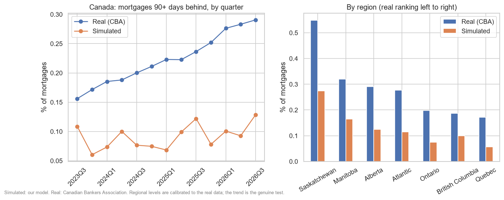

### Step 7 — Charts (notebook 04)

Pulls data with SQL, reshapes it with pandas (`groupby`, `pivot`, `pd.cut`, `merge`), draws 10
charts with matplotlib/seaborn, saves them to `images/`. See §15.

### Step 8 — Prediction model (notebook 05)

**Logistic regression** — the standard first model in credit risk. It takes a few facts about a
loan and outputs a **probability of default** between 0 and 1.

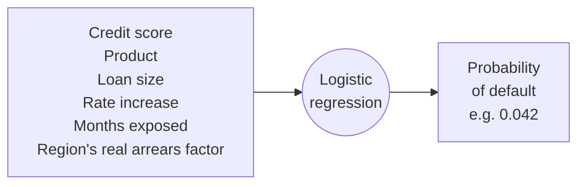

| Term | Plain meaning |
| --- | --- |
| **Feature** | An input the model uses (credit score, product…). |
| **Target** | What we predict (did the loan default: 1 or 0). |
| **Train / test split** | Learn from 70% of loans; grade on the 30% it never saw — like studying past papers, then sitting a new exam. |
| **AUC** | How well the model ranks risky above safe. 0.5 = coin flip, 1.0 = perfect. **Ours: 0.770.** |
| **Decile table** | Sort loans riskiest → safest, split into 10 groups, count defaults in each. **The riskiest 20% hold 55% of defaults.** |
| **Odds ratio** | How much one feature multiplies the odds of default. 0.44 per 100 credit points = each 100 points cuts the odds by ~56%. |
| **Data leakage** | When a feature secretly contains the answer — it makes the model look better than it is. |

**Honest framing:** we wrote the rules that create defaults, so a good model should **recover**
them. It did: the credit-score odds ratio is **0.44** vs the **0.5** we built in, and the coefficient
on the (log) regional arrears factor is **1.13** vs the **1** we built in. That proves the workflow
works; it isn't evidence about real borrowers.

---

## 11. Every variable, explained

### `config/pipeline.yml` — the settings

| Setting | Value | Why it exists |
| --- | --- | --- |
| `seed` | 42 | Same random numbers every run → reproducible |
| `window.origination_start` | 2015-01 | Earliest signing date. Must be 10 years before 2025 so 2025 has *second* renewals of 2015 loans |
| `window.performance_start / end` | Apr 2023 – Sep 2026 | The 42 months we simulate payment behaviour |
| `window.renewal_window_*` | 2025 – 2027 | The renewal wave we analyse |
| `future_rates` | flat | Renewals after Sep 2026 use the last real rate |
| `portfolio.n_loans` | 50,000 | Big enough for patterns, small enough for a laptop |
| `product_mix` | 35/10/20/35 | Share of loans by product |
| `mortgage_fixed_share` | 0.75 | Share of mortgages that are fixed |
| `credit_score` | mean 720, sd 70 | Shape of the score distribution |
| `original_balance` | per product min–max | Loan size range |
| `risk.*.fixed_spread_over_goc_5yr` | 1.40 | Converts bond yield to what people really pay |
| `risk.*.score_sensitivity_per_100pts` | 0.15 (mortgage) … 5.5 (card) | How much better credit lowers the rate |
| `risk.*.fixed_rate_floor` | 1.35% | Real fixed rates never went below this |
| `risk.*.target_cum_default_42m` | 0.5% … 5% | Normal-times default rates to calibrate to |
| `risk.*.cure_rate` | 30–50% | Monthly chance a late loan catches up |
| `risk.*.lgd` | 10% … 85% | Share of a defaulted balance that's lost |
| `hazard_drivers.rate_increase_per_pp` | 0.25 | Each +1pp rate rise → +25% chance of missing a payment |
| `hazard_drivers.score_points_to_double_risk` | 100 | 100 points lower → risk doubles |
| `sources.statcan` | table 14-10-0287, member codes | Where to fetch real unemployment and population |
| `sources.cba_arrears` | Excel URL, sheet names, province → region map | Where to fetch real arrears; the URL's month changes when the CBA publishes |
| `analysis.severe_payment_shock_pct` | 25 | "At-risk" cut-off for the headline KPI |

### `data/rates.csv` — REAL

| Column | Meaning |
| --- | --- |
| `month` | First day of the month |
| `policy_rate` | Bank of Canada policy rate, monthly average (%) |
| `prime_rate` | Prime rate (%) |
| `goc_5yr_yield` | 5-year Government of Canada bond yield (%) |
| `posted_5yr_mortgage` | Posted (sticker) 5-year mortgage rate (%) |
| `source` | "Bank of Canada Valet API (real)" |

### `data/unemployment.csv` → `fact_province_month` — REAL (Statistics Canada)

| Column | Meaning |
| --- | --- |
| `month`, `province` | One province (or CA = Canada) in one month |
| `unemployment_rate` | % of the labour force without a job, seasonally adjusted |
| `population_thousands` | People aged 15+, in thousands (used to weight averages and split Atlantic Canada) |

### `data/mortgage_arrears.csv` → `raw.mortgage_arrears` — REAL (Canadian Bankers Association)

| Column | Meaning |
| --- | --- |
| `month`, `region` | One CBA region (Atlantic is the four Atlantic provinces combined) in one month |
| `total_mortgages` | Mortgages held by the reporting banks |
| `mortgages_in_arrears` | Of those, how many are 3+ months (90+ days) behind |
| `arrears_rate` | `mortgages_in_arrears` ÷ `total_mortgages` |

### `dim_province` and `arrears_validation`

| Column | Meaning |
| --- | --- |
| `cba_region` | The CBA region a province belongs to |
| `real_arrears_factor` | The region's real arrears rate ÷ Canada's, over the window (Saskatchewan 2.58) |
| `simulated_mortgages`, `simulated_in_arrears` | Our model's counts for a region and month |
| `real_mortgages`, `real_in_arrears` | The CBA's counts (blank for Aug–Sep 2026: not published yet) |

### `data/loans.csv` → `dim_loan` / `fact_renewal` — SIMULATED

| Column | Meaning |
| --- | --- |
| `loan_id` | Unique loan number |
| `product` | mortgage / heloc / auto / card |
| `province` | Two-letter province code (ON, QC…) |
| `credit_score`, `credit_band` | Score 300–900 and its band |
| `rate_type` | fixed / variable |
| `original_balance` | Amount borrowed ($) |
| `origination_month`, `vintage_year` | When the loan was signed (vintage = signing year) |
| `rate_at_signing` | Interest rate when signed (%) |
| `renews_in_window` | True if a fixed mortgage renewing in 2025–27 |
| `renewal_month`, `renewal_year` | When it renews |
| `already_renewed` | True if the renewal is before Sep 2026 (shock already happened) |
| `old_rate`, `new_rate`, `rate_jump_pp` | Rate before/after renewal and the difference |
| `balance_at_renewal` | Still owed at renewal ($) |
| `old_payment`, `new_payment` | Monthly payment before/after ($) |
| `payment_increase`, `annual_payment_increase` | Extra per month / per year ($) |
| `payment_shock_pct` | % increase in the monthly payment |
| `shock_band` | 0-10% / 10-25% / Over 25% |
| `is_severe_shock` | True if shock > 25% (the "at-risk" flag) |
| `has_defaulted` | True if it defaulted during the 42 months |
| `new_rate_source` | "real rate" or "assumed: last real rate held flat" |
| `region_factor` | The province's real arrears factor (from `dim_province`) |
| `base_pd_12m`, `stressed_pd_12m` | 12-month default probability before/after the rate jump (band PD × region factor) |
| `loss_given_default` | 0.10 for mortgages |
| `expected_loss_before`, `expected_loss_after` | Balance × PD × LGD ($) |
| `incremental_provision` | After − before ($) — extra money to set aside |
| `can_contact` | Not yet renewed and not defaulted — the bank can still reach them |
| `outreach_priority` | 1 = call first |
| `source` | "SIMULATED - not real customers" |

### `data/loan_months.parquet` → `fact_loan_month` — SIMULATED

| Column | Meaning |
| --- | --- |
| `loan_id`, `month` | Which loan, which month (the grain) |
| `status` | current / 30 dpd / 60 / 90 / 120 / default |
| `balance` | Owed that month ($) |
| `delinquent_balance` | Balance if 30–120 dpd, else 0 |
| `impaired_balance` | Balance if 90–120 dpd, else 0 |
| `defaulted_balance` | Balance in the month it defaulted, else 0 |
| `rate_increase_pp` | How much its rate has risen since signing (pp) |

*(Parquet is a compressed file format — about 10× smaller than CSV and it keeps column types.)*

---

## 12. What we included, what we left out, and why

| Considered | Decision | Why |
| --- | --- | --- |
| Real customer loan data | ❌ Not available | No lender publishes it → simulate, honestly labelled |
| Real interest rates | ✅ Included | Makes the simulation respond to what actually happened |
| Real mortgage arrears by region (CBA) | ✅ Included | Places loans where mortgages really are, sets regional risk, and checks the simulation |
| Posted mortgage rate as the price | ❌ Rejected | It's a sticker price; bond yield + spread matches what people paid |
| Postgres database | ❌ Dropped | Needs a server and a second SQL dialect; DuckDB runs anywhere, SQL is standard |
| dbt (SQL transformation tool) | ⏳ Later | Useful keyword; plain SQL first, port later |
| Statistics Canada unemployment by province | ✅ Included | Drives *when* risk rises; also showed it doesn't explain *where* |
| Real loan-level data from US agencies (Freddie Mac) | ❌ Not used | Real, but US mortgages lock rates for 30 years, so there's no renewal problem to study |
| Modelling foreclosure timelines | ❌ Out of scope | Would close the arrears level gap; reported instead |
| Streamlit web app | ❌ Dropped | Power BI is what Canadian banks use |
| Automated monthly runs (GitHub Actions) | ❌ Dropped | Not needed for an analyst portfolio |
| Lender-rate web scraper | ❌ Dropped | Scope; legal checks needed |
| Unit tests (pytest) | ❌ → SQL checks | Analysts check data with queries; that's what employers ask for |
| Forecasting future rates | ❌ Deliberately not | Can't be defended; we hold the last real rate flat and say so |
| Average interest rate as a KPI | ❌ | Averages a 5% mortgage with a 20% card — meaningless |
| "Portfolio health score" | ❌ | A blended index nobody can explain when it moves |

---

## 13. Assumptions

Every judgement call is tagged `[ASSUMPTION]` in `config/pipeline.yml`. The important ones:

| Assumption | Effect if wrong |
| --- | --- |
| Product mix 35/10/20/35 | Changes portfolio totals, not the renewal story |
| 75% of mortgages are fixed | More fixed → bigger renewal wave |
| Fixed mortgage = bond yield + 1.40pp | Shifts all fixed rates up/down together; shock % barely changes |
| Rates after Sep 2026 held flat | If rates fall, 2027 shock is smaller; if they rise, bigger |
| +25% default chance per +1pp rate rise | Directly scales the provision figure |
| 100 credit points = 2× risk | Shapes how much provision sits in low bands |
| LGD 10% for mortgages | Scales the provision linearly |
| Province mix = real mortgage counts, same for every product | Fine for mortgages; HELOCs, autos and cards may be distributed differently |
| Risk proportional to the regional arrears factor | Scales provision up in Saskatchewan, down in Quebec |
| Risk proportional to national unemployment over time | Shapes the trend; the real trend rose faster than the simulation |
| HELOC and card balances flat over time | Simplifies balances; minor effect |

---

## 14. The biggest challenges

### Domain traps (avoided by design)

1. **Posted vs real rates** — using the posted rate would have overstated every payment (§4).
2. **YAML reads `ON` as `true`** — in the config file, an unquoted `ON:` (Ontario) silently became
   the boolean `True`. Province codes are quoted (`"ON":`).
3. **A naive roll-rate model produces no defaults** — if late loans needed a fresh "miss" draw to
   move on, they'd sit at 30 dpd forever. Correct: late loans cure or roll.
4. **Averaging ratios** — stored amounts, computed rates as SUM ÷ SUM (§10).

### Bugs found by checking the numbers

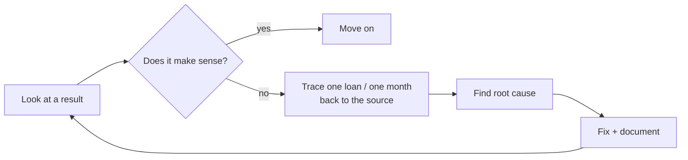

| Bug | How it showed up | Root cause | Fix |
| --- | --- | --- | --- |
| **Shared random seed** | In month 1, mortgages had 93 late loans (~30 expected) and cards had **zero** | Both simulations used seed 42, so month-1 "miss a payment" draws were the exact numbers that had picked each loan's product | Separate seed for notebook 02 |
| **Model data leakage** | "More months on book → *less* default" — backwards | Defaulted loans leave the data, so they automatically have fewer months; the feature contained the answer. AUC 0.84 looked great but was fake | Count months the loan *could* be observed |
| **Non-reproducible model** | Same code, different coefficients each run | DuckDB returns rows in no fixed order → different train/test split | `ORDER BY loan_id` |
| **2025 renewals undercounted** | 2025 had half the renewals of 2026–27 | Loans started in 2016, missing 2015 signings that renew a second time in 2025 | Start in 2015 |
| **At-risk mismatch** | $245.6M in one table, $244.9M in another | "25%+" band included exactly 25%; the KPI used "> 25%" | One definition: "Over 25%" |
| **Wrong regional driver** | With unemployment by province as the driver, Atlantic Canada ranked riskiest; real arrears say Saskatchewan | Real unemployment doesn't explain regional arrears (correlation −0.29) | Real arrears for *where*, unemployment for *when* |
| **Real data lag** | The fetch check failed: 16 rows missing | The CBA's file ends Jul 2026; our window ends Sep 2026 | Keep what exists, never fill gaps, log a warning |
| **Files not committed** | The Power BI CSVs weren't in GitHub | The ignore rule `data/` also matched `powerbi/data/` | Ignore only the top-level `/data/` |

> **Lesson:** a result that runs without errors can still be wrong. Every bug above was found by
> asking "does this number make sense?" and tracing one example back to the source.

### Environment challenges

- **Python version:** the analysis tool dbt doesn't support Python 3.13+, so the project uses 3.12.
- **Memory:** numpy crashed at start-up when the laptop was low on memory; fixed by limiting its
  threads (`OPENBLAS_NUM_THREADS=4`).
- **GitHub account mix-up:** cached credentials for the wrong account caused push failures.

---

## 15. Results and conclusion

All numbers come from `sql/04_analysis_queries.sql` (results in notebook 03).

### Headline numbers [Q12]

| KPI | Value |
| --- | --- |
| Total exposure (all loans, Sep 2026) | **$8.40B** |
| Delinquency rate (30–120 dpd) | **0.58%** |
| Impaired rate (90–120 dpd) | **0.10%** |
| Fixed mortgages renewing 2025–27 | **6,716** ($2.70B) |
| Balance-weighted payment shock | **+15.2%** |
| At-risk exposure (shock > 25%) | **$244.9M** |
| Added payments for households | **$28.3M per year** |
| Extra provision implied | **$211,222** |
| Borrowers still reachable | **2,797** |

### Finding 1 — The wave is big, and 2025–26 is the worst of it [Q1]

| Renewal year | Loans | Balance | Weighted shock | Already renewed |
| --- | --- | --- | --- | --- |
| 2025 | 2,189 | $852.8M | +19.8% | all |
| 2026 | 2,250 | $900.8M | +20.2% | 1,716 |
| 2027 | 2,277 | $950.0M | +6.3% | none |

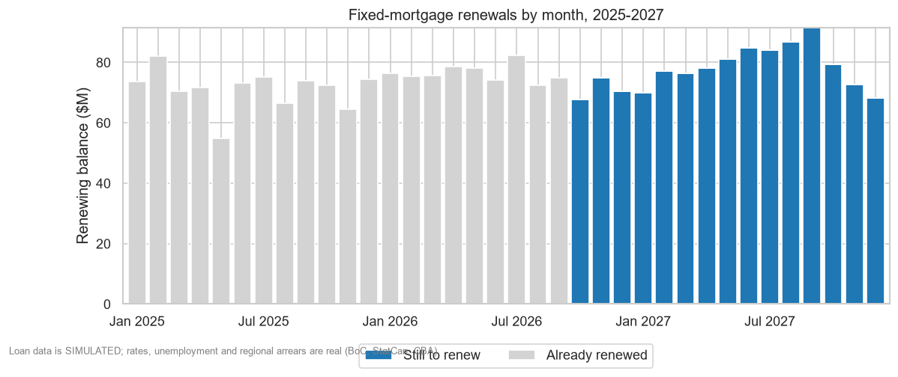

### Finding 2 — The shock depends on *when* the rate was locked, not on *who* [Q3, Q5]

| Term started | Old rate (median) | New rate (median) | Shock (median) | Extra per month (median) |
| --- | --- | --- | --- | --- |
| 2020 | 1.82% | 4.20% | +19.1% | $405 |
| 2021 | 2.28% | 4.56% | +20.2% | $450 |
| 2022 | 4.38% | 4.94% | +4.2% | $120 |

Every credit band's lift into the high-shock group is between **0.86 and 1.02** — basically even.

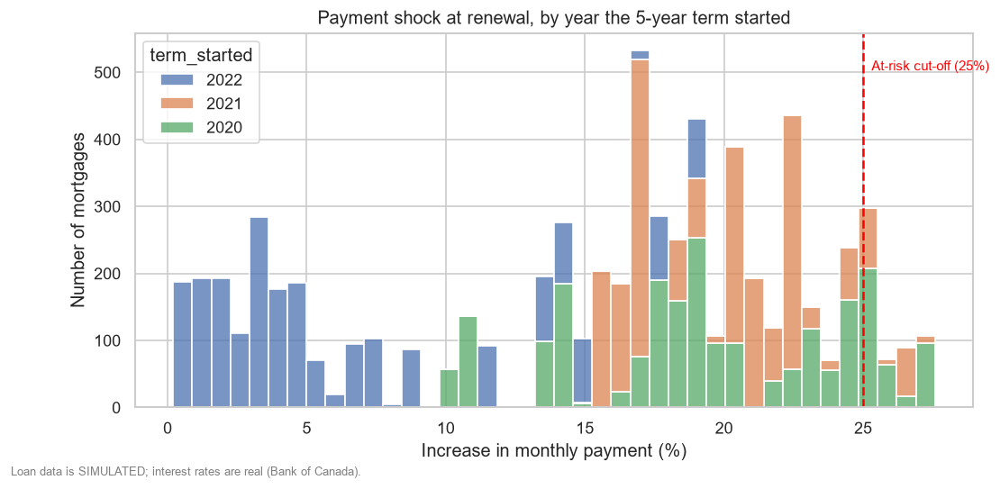

### Finding 3 — The risk is where shock meets weak credit [Q6, Q8]

Default rates fall steadily with credit score (mortgages: 1.91% below 600 → 0.28% at 780+;
cards: 12.66% → 1.96%). "Below 600" borrowers' 12-month PD rises from 0.55% to 0.79% with the shock [Q6].

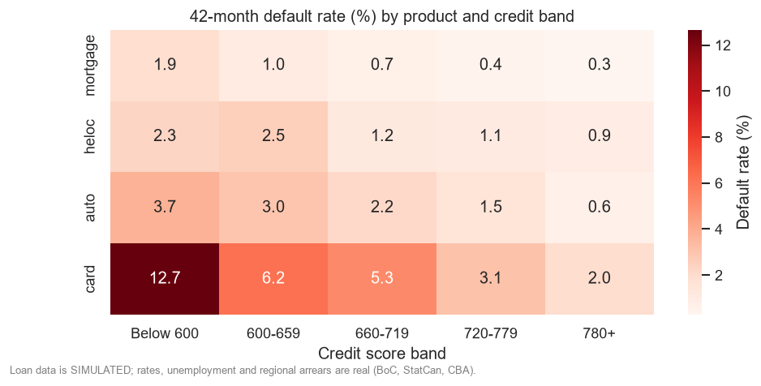
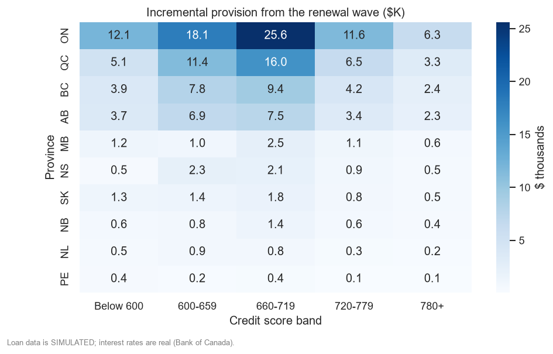

### Finding 3b — Where you live matters, and real data says where [Q4, Q15]

Real CBA data shows Saskatchewan's mortgages fall 90+ days behind **2.58×** as often as Canada's;
Quebec's **0.78×**. So the extra provision per $1M of renewing balance is **$213 in Saskatchewan**
vs **$63 in Quebec**. Ontario still holds the most in total (**38.8%**) because it's the biggest.
And it isn't unemployment: Saskatchewan's (5.3%) is among the lowest.

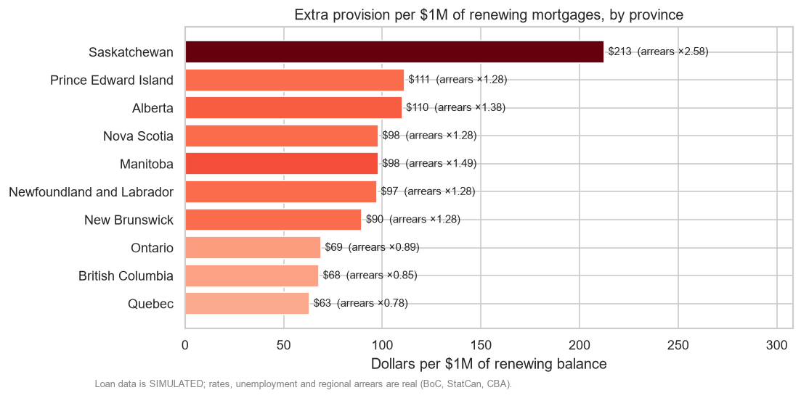

### Finding 4 — No one in this wave gets cheaper (with rates held flat)

Rates peaked in late 2022 near today's level, so every 2025–27 renewal costs more. Loans signed in
2023–24 will reprice *cheaper* — in 2028–29.

### Finding 5 — Real rate rises showed up in variable-rate debt [Q9]

As prime climbed to 7.2%, HELOC delinquency rose from **0.48% to a peak of 0.88%** (Q1 2024), then eased.

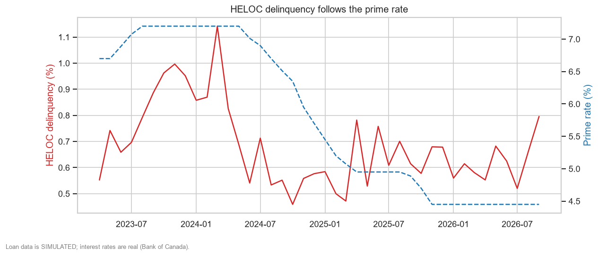

### Finding 6 — A ranked call list [Q10]

The top 3 are in **Alberta and Saskatchewan** (high real arrears). The top 15 all have credit
scores of 640 or below and renew Oct 2026 – Mar 2027, most with a ~2pp rate jump. #1 is loan 30258
(worked example in §7).

### Conclusion

1. The 2025–27 renewal wave raises payments by about **20%** for loans locked in 2020–21.
2. The shock is a **timing** effect that hits all credit bands equally; the **risk** concentrates
   where it meets weak credit and high-arrears regions (Saskatchewan, Manitoba, Alberta).
3. The extra provision is modest relative to the book, because mortgages are secured
   (LGD 10%) — but it's concentrated, which makes **targeted outreach** the efficient response.
4. The bank should **call the 2,797 still-reachable borrowers in priority order**, starting with
   low-score borrowers renewing in the next few months.

---

## 16. Limitations

- **Simulated loan book:** findings describe this portfolio, not real Canadian borrowers.
- **Simulated arrears are ~0.4× the real level** (the model writes loans off after 120 days).
- **Regional risk is calibrated** to real arrears, so the regional match isn't evidence; only the
  time trend is a genuine test, and it's loose (correlation 0.41).
- **Flat future rates** is an assumption, not a forecast.
- **Small default counts** in some segments (7–26 mortgage defaults per credit band) → noisy PDs.
- **The rate-effect assumption** (+25% per pp) directly scales the provision figure.
- **The model can't separate** "being a HELOC" from "facing a rate rise", because almost every
  HELOC saw the same +4.75pp prime increase.

---

## 17. Power BI dashboard results

> *To be added once the dashboard is built (see `docs/POWERBI_GUIDE.md`).*
>
> Suggested contents: a screenshot of each page, a link to the published report, and a note
> confirming the KPI cards match Q12.

---

## 18. Interview questions to practise

| Question | Short answer |
| --- | --- |
| Why is this a Canadian problem? | Canadian mortgages lock the rate for 5 years of a 25-year loan; US mortgages lock it for 30. |
| Why not use the published mortgage rate? | It's the posted (sticker) rate; people pay ~bond yield + 1.4pp. |
| Is your data real? | Rates, unemployment and mortgage arrears are real (Bank of Canada, StatCan, CBA). The loans are simulated and labelled, because banks don't publish customer data, but they're driven by the real data and checked against it. |
| How did you validate the simulation? | Drove it with real unemployment, checked it against real arrears (a different source): trend correlation 0.41, level 0.41× real, with a structural reason for the gap. |
| Does unemployment explain arrears? | Over time yes (0.69); across regions no (−0.29). So I used each for what it explains. |
| What's payment shock? | New payment ÷ old payment − 1, at renewal. |
| Why only fixed mortgages? | Variable borrowers felt rate rises month by month; fixed ones feel it all at renewal. |
| What's a provision? | Money set aside in advance for expected losses = balance × PD × LGD. |
| Why store amounts, not rates? | So rates stay correct under any filter (SUM ÷ SUM); averaging ratios over-weights small accounts. |
| What's a star schema? Grain? | Dimensions describe, facts hold numbers; grain = what one row means. |
| How do you know the data is right? | 23 checks across completeness, uniqueness, validity, consistency, reconciliation; build stops on failure. |
| What's lift and why use it? | Share of a group ÷ share of the base; a bare % is meaningless without the base. |
| Tell me about a mistake. | The shared seed (month-1 cards never missed a payment), the leakage (a flattering AUC of 0.84), or driving regional risk with unemployment before checking real arrears. |
| Why logistic regression? | Standard, explainable credit model; coefficients become odds ratios a manager understands. |
| What would you add next? | Model foreclosure timelines to close the arrears level gap, dbt for the SQL, and rate scenarios (rates fall / rise). |
